<h1 align="center">🐦 Alas de Señas</h1>

<p align="center">
  <strong>Aprender Lengua de Señas Colombiana, una lección a la vez.</strong><br>
  Proyecto académico de Ingeniería de Sistemas · Educación · Visión por computador
</p>

<p align="center">
  <a href="#proyecto">El proyecto</a> ·
  <a href="#estado">Estado</a> ·
  <a href="#capas">Explorar las capas</a> ·
  <a href="#arquitectura-del-proyecto">Arquitectura</a> ·
  <a href="#documentacion">Documentación</a>
</p>

---

<a id="proyecto"></a>

## El proyecto

**Alas de Señas** es una plataforma web para aprender **Lengua de Señas Colombiana (LSC)** mediante lecciones cortas, recursos visuales y práctica. **Tomi**, un colibrí, acompaña el recorrido de aprendizaje.

El proyecto completo reúne estas experiencias:

| Experiencia | Propósito |
|---|---|
| **Aprendizaje guiado** | Avanzar por módulos, niveles y lecciones con ejercicios de observación, memoria y conversación. |
| **Diccionario visual** | Consultar señas y su significado mediante imágenes y videos. |
| **Práctica con cámara** | Explorar el reconocimiento de señas estáticas y con movimiento como apoyo al aprendizaje. |
| **Progreso y motivación** | Mantener el hábito con experiencia, rachas, logros y repasos. |

La experiencia está orientada a computadores y portátiles. La cámara es una herramienta de práctica; la validación de las señas y sus variantes corresponde a una persona competente en LSC, según la [guía de validación](docs/validacion-interprete.md).

<a id="estado"></a>

## Estado de la entrega

> [!IMPORTANT]
> Este repositorio publica el proyecto **por capas**. Ya incluye base de datos, contenido, entrenamiento, documentación y herramientas de soporte. Las carpetas de frontend, rutas HTTP, formatos JSON, reglas de negocio y servicios contienen únicamente `.gitkeep`.
>
> **Esta entrega todavía no permite ejecutar la aplicación completa.**

| Estado | Incluye |
|---|---|
| **Publicado** | Modelos y repositorios de datos, migraciones, configuración de PostgreSQL, señas y lecciones, videos, datasets, scripts de entrenamiento, notebooks, documentación y comandos de soporte. |
| **Pendiente de incorporar** | Interfaz React, rutas de la API, esquemas JSON, dominio y servicios. |

Los comandos de desarrollo, las migraciones, las pruebas de integración y el despliegue de la aplicación dependen de las capas pendientes. La [CI](.github/workflows/ci.yml) comprueba si existe el código necesario antes de ejecutarlas; un workflow correcto en esta etapa no equivale a una validación funcional de toda la aplicación.

<a id="capas"></a>

## Explorar por capas

Los nombres y el orden coinciden con el workspace de VS Code. Despliega una entrada para abrir su carpeta y conocer su función.

<details open>
<summary><strong>alas-de-senas (Workspace)</strong></summary>

<details>
<summary>1 · Frontend (React)</summary>

[Abrir carpeta →](apps/web/) · `apps/web`

Pantallas, navegación y experiencia de aprendizaje. **Pendiente**; solo contiene `.gitkeep`.

</details>

<details>
<summary>2 · API — rutas HTTP</summary>

[Abrir carpeta →](apps/api/app/api/) · `apps/api/app/api`

Puntos de entrada HTTP para las acciones de la aplicación. **Pendiente**; solo contiene `.gitkeep`.

</details>

<details>
<summary>2 · API — formatos JSON</summary>

[Abrir carpeta →](apps/api/app/schemas/) · `apps/api/app/schemas`

Validación y contratos de los datos que entran y salen de la API. **Pendiente**; solo contiene `.gitkeep`.

</details>

<details>
<summary>3 · Backend — reglas de negocio</summary>

[Abrir carpeta →](apps/api/app/domain/) · `apps/api/app/domain`

Reglas de evaluación, progreso, vidas, experiencia y repaso. **Pendiente**; solo contiene `.gitkeep`.

</details>

<details>
<summary>3 · Backend — servicios</summary>

[Abrir carpeta →](apps/api/app/services/) · `apps/api/app/services`

Coordinación de los casos de uso y acceso a los repositorios. **Pendiente**; solo contiene `.gitkeep`.

</details>

<details>
<summary>4 · Base de datos — modelos y repositorios</summary>

[Abrir carpeta →](apps/api/app/infra/) · `apps/api/app/infra`

**Publicado.** Modelos SQLAlchemy, conexiones y repositorios de persistencia. Empieza por [`models.py`](apps/api/app/infra/models.py) y [`repositories/`](apps/api/app/infra/repositories/).

</details>

<details>
<summary>4 · Base de datos — migraciones</summary>

[Abrir carpeta →](apps/api/alembic/) · `apps/api/alembic`

**Publicado.** Evolución del esquema con Alembic. Incluye las [versiones de las migraciones](apps/api/alembic/versions/), su [configuración](apps/api/alembic.ini) y el entorno PostgreSQL de [`docker-compose.yml`](docker-compose.yml).

</details>

<details>
<summary>Contenido (señas y lecciones)</summary>

[Abrir carpeta →](content/) · `content`

**Publicado.** Catálogo de señas, currículo, conversaciones y videos, con el registro de fuentes y licencias de los datasets.

</details>

<details>
<summary>Entrenamiento del modelo</summary>

[Abrir carpeta →](ml/) · `ml`

**Publicado.** Entrenamiento de modelos estáticos y temporales, notebooks para Google Colab, datasets, pruebas y fixtures.

</details>

<details>
<summary>Documentación</summary>

[Abrir carpeta →](docs/) · `docs`

**Publicado.** Requisitos, diseño, arquitectura, decisiones técnicas, bitácora y guías de trabajo.

</details>

<details>
<summary>Proyecto completo (comandos)</summary>

[Abrir carpeta →](./) · Raíz del repositorio

**Publicado como soporte.** Configuración, CLI, herramientas compartidas y pruebas originales. Esta vista reúne los archivos de la raíz; no significa que las capas pendientes ya estén incorporadas.

</details>

</details>

Estos nombres son vistas definidas en [`alas-de-senas.code-workspace`](alas-de-senas.code-workspace). El explorador de archivos de GitHub muestra las rutas reales.

<a id="arquitectura-del-proyecto"></a>

## Arquitectura

El diseño separa la presentación, la API, las reglas de negocio y la persistencia. El entrenamiento del modelo se mantiene en un entorno independiente.

```mermaid
flowchart LR
    UI["1 · Frontend<br/>React"] -->|HTTP / JSON| API["2 · API<br/>FastAPI + Pydantic"]
    API --> BE["3 · Backend<br/>Dominio + servicios"]
    BE --> DB["4 · Base de datos<br/>SQLAlchemy + PostgreSQL"]
    DATA["Contenido y datasets"] --> ML["Entrenamiento<br/>TensorFlow"]
    ML -.->|Modelos para el navegador| UI

    classDef pendiente fill:#f6f8fa,stroke:#6e7781,color:#24292f,stroke-dasharray:5 5;
    classDef publicado fill:#dafbe1,stroke:#1a7f37,color:#116329;
    class UI,API,BE pendiente;
    class DB,DATA,ML publicado;
```



Los bloques con borde discontinuo corresponden a las capas pendientes de publicar. El diagrama describe el diseño del proyecto completo; el flujo de la aplicación requiere todas sus capas.

| Área | Tecnologías del proyecto |
|---|---|
| Interfaz y cámara | React 19, TypeScript, Vite, Tailwind CSS, MediaPipe y TensorFlow.js |
| API y lógica | Python 3.12, FastAPI y Pydantic |
| Persistencia | PostgreSQL 16, SQLAlchemy y Alembic |
| Entrenamiento | Python 3.11, TensorFlow 2.15.1, NumPy y scikit-learn |
| Entorno y calidad | uv, Docker, pytest, Ruff y GitHub Actions |

Consulta las responsabilidades y los flujos en la [guía de estructura](docs/ESTRUCTURA.md).

## Empezar a explorar

Para revisar esta entrega solo necesitas Git y un editor:

```bash
git clone https://github.com/rcamilorodriguez1/Alas-De-Senas-Proyecto.git
cd Alas-De-Senas-Proyecto
```

En VS Code, selecciona **Archivo → Abrir área de trabajo desde archivo…** y abre `alas-de-senas.code-workspace`. Si tienes disponible el comando `code`, también puedes ejecutar:

```bash
code alas-de-senas.code-workspace
```

| Si quieres… | Empieza aquí |
|---|---|
| Comprender qué debe hacer el sistema | [Requisitos](docs/specs/requirements.md) y [diseño](docs/specs/design.md) |
| Revisar las tablas y sus cambios | [Modelos](apps/api/app/infra/models.py) y [migraciones](apps/api/alembic/versions/) |
| Consultar el material de aprendizaje | [Señas](content/signs.csv), [currículo](content/curriculum.json) y [videos](content/videos/raw/) |
| Estudiar el reconocimiento de señas | [Notebooks](ml/notebooks/), [datasets](ml/data/) y [entrenamiento](#entrenamiento) |
| Entender las decisiones técnicas | [Registro de decisiones](docs/DECISIONES.md) |

La [guía del proyecto completo](docs/README-proyecto-completo.md) conserva la referencia de instalación y ejecución de la aplicación. Sus instrucciones requieren las capas que aún no se publican aquí.

<a id="entrenamiento"></a>

## Entrenamiento del modelo

La carpeta [`ml/`](ml/) contiene dos recorridos de entrenamiento:

| Modelo | Código | Notebook |
|---|---|---|
| **Señas estáticas** | [`train_static.py`](ml/train_static.py): aprende a partir de puntos de una mano. | [Entrenamiento estático](ml/notebooks/entrenamiento.ipynb) |
| **Señas con movimiento** | [`train_sequence.py`](ml/train_sequence.py): trabaja con secuencias de puntos corporales y de las manos. | [Entrenamiento de gestos](ml/notebooks/entrenamiento-gestos.ipynb) |

Su entorno usa **Python 3.11** y tiene sus propias [dependencias](ml/pyproject.toml) y [archivo de versiones](ml/uv.lock), separados del backend en Python 3.12. Los notebooks explican la preparación de datos y la ejecución en Google Colab.

Los [fixtures](ml/fixtures/) y las [pruebas de entrenamiento](ml/tests/) acompañan el procesamiento de datos. La [guía de grabación](docs/guia-grabacion-gestos.md) describe cómo aportar muestras para los gestos con movimiento.

<a id="documentacion"></a>

## Documentación

| Documento | Qué encontrarás |
|---|---|
| [Requisitos](docs/specs/requirements.md) | Objetivos y criterios de aceptación. |
| [Diseño](docs/specs/design.md) | Solución propuesta para los requisitos. |
| [Especificación técnica](docs/especificacion.md) | Contratos y reglas del sistema. |
| [Estructura del proyecto](docs/ESTRUCTURA.md) | Capas, responsabilidades y ejemplos de comunicación. |
| [Decisiones técnicas](docs/DECISIONES.md) | Motivos de las decisiones tomadas durante el desarrollo. |
| [Bitácora](docs/PROGRESS.md) | Avance y registro del trabajo realizado. |
| [Validación de LSC](docs/validacion-interprete.md) | Revisión del contenido con una persona competente en LSC. |

## Flujo de trabajo

Los cambios se organizan en ramas por capa y se incorporan mediante pull requests:

1. Crear una rama con un alcance concreto, por ejemplo `feat/base-de-datos`, `feat/contenido` o `docs/actualizacion`.
2. Preparar commits que describan el cambio y verificar los archivos de esa capa.
3. Abrir un pull request hacia `main`, explicando el resultado y la validación realizada.
4. Esperar la revisión y aceptación del propietario antes de fusionar.

Las carpetas pendientes conservan su `.gitkeep` hasta la entrega de su implementación. Las nuevas capas deben incorporarse de forma explícita.

## Datos, créditos y licencias

Las fuentes utilizadas están registradas en [`content/datasets.csv`](content/datasets.csv):

| Dataset | Autores y fuente | Licencia registrada |
|---|---|---|
| **LSC-54** | Mora-Zarate, Garzón-Castro y Castellanos-Rivillas (2025), Universidad de La Sabana. [Fuente](https://doi.org/10.57760/sciencedb.25639). | CC BY-NC 4.0: atribución y uso no comercial. |
| **LSC70** | Muñoz Galindez, Villota Coral y Vargas-Canas (2024), Universidad del Cauca. [Fuente](https://doi.org/10.17632/9ssyn8tff5.2). | CC BY 4.0: atribución. |

Esta entrega incluye los videos disponibles en [`content/videos/raw/`](content/videos/raw/) y los datasets locales de [`ml/data/`](ml/data/). Al reutilizarlos, conserva la atribución y las condiciones de cada fuente.

El código del proyecto aún no tiene una licencia de distribución definida. Las licencias de los datasets corresponden a esos datos y no constituyen una licencia para el código.

---

Mantenido por [Rafael Camilo Rodriguez Ayala](https://github.com/rcamilorodriguez1). Proyecto de origen: [alas-de-senas](https://github.com/rcamilorodriguez1/alas-de-senas).
